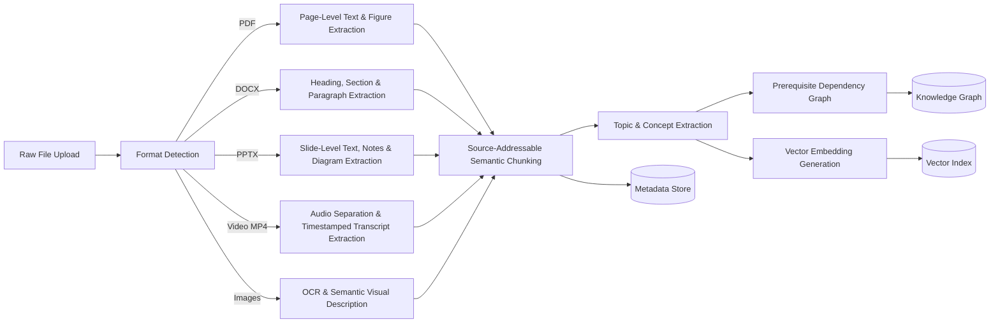

# EduPath AI — Multimodal Adaptive Learning Companion
## System Architecture & Technical Specification

> **Document Version:** 2.0.0  
> **Status:** Production / Hackathon Ready  
> **Author:** Antigravity Engineering Team  

---

## 1. Executive Product Vision

EduPath AI is a unified, source-grounded, multimodal, and adaptive learning companion. Rather than presenting a disjointed collection of standalone AI utilities (e.g. a chatbot, a random quiz generator, and disconnected flashcards), EduPath AI unifies all educational interactions around **three shared intelligence layers**:

```
                       ┌────────────────────────────────────────────────────────┐
                       │               SHARED MULTIMODAL KNOWLEDGE BASE          │
                       │   (PDF, DOCX, PPTX, Video Transcripts, Figures, Graph) │
                       └──────────────────────────┬─────────────────────────────┘
                                                  │
                                                  ▼
                       ┌────────────────────────────────────────────────────────┐
                       │                 SHARED LEARNER MODEL                   │
                       │   (Mastery Vector, Confidence, Recency, Misconceptions)│
                       └──────────────────────────┬─────────────────────────────┘
                                                  │
                                                  ▼
                       ┌────────────────────────────────────────────────────────┐
                       │               ADAPTIVE LEARNING ENGINE                 │
                       │   (Diagnostic, Tutor, Quizzes, Remediation, Planner)   │
                       └────────────────────────────────────────────────────────┘
```

Every user action—reading course material, asking the tutor a question, answering a quiz question, reviewing a flashcard, or practicing in the coding lab—both **reads from** and **updates** these shared layers.

---

## 2. High-Level System Architecture

```mermaid
flowchart TD
    subgraph Client ["Frontend Client (React + Vite + Tailwind)"]
        UI_Dash["Dashboard & Timeline"]
        UI_Tutor["Grounded Multimodal Tutor"]
        UI_Assess["Adaptive Assessment Engine"]
        UI_Graph["Interactive Knowledge Graph"]
        UI_Explorer["Source Explorer & Video Player"]
        UI_Plan["Adaptive Study Planner"]
        UI_Flash["SM-2 Flashcards & Revision"]
        UI_Code["Secure Coding Sandbox"]
    end

    subgraph API ["FastAPI Backend Services"]
        Router_Auth["Auth & Session Controller"]
        Router_Course["Course & Ingestion Controller"]
        Router_Tutor["Tutor & Source-Scoped Chat"]
        Router_Assess["Adaptive Assessment Controller"]
        Router_Learner["Learner & Mastery Service"]
        Router_Planner["Planner & Recommendation Engine"]
        Router_Sandbox["Isolated Code Execution Engine"]
    end

    subgraph Intelligence ["Core Intelligence Systems"]
        Engine_Ingest["Multimodal Ingestion Pipeline\n(PDF / DOCX / PPTX / Video / OCR)"]
        Engine_Graph["Knowledge Graph Builder\n(Topics, Concepts, Prerequisites)"]
        Engine_RAG["Hybrid RAG Retriever\n(Vector + BM25 + Graph Reranking)"]
        Engine_Ground["Grounding & Refusal Gate\n(Citation Verification)"]
        Engine_Learner["Bayesian Learner Model\n(Mastery Scale: 0.00 - 1.00)"]
        Engine_Misconception["Why Was I Wrong? Misconception Engine"]
        Engine_Validation["Assessment Verification Pipeline\n(Generator -> Solver -> Validator -> Approver)"]
    end

    subgraph Storage ["Storage & Persistence"]
        DB[(SQLite / PostgreSQL\nRelational Database)]
        VectStore[(Vector Store\nEmbeddings Index)]
        FileStore[(Local Uploads / GCS\nCourse Documents & Media)]
    end

    Client --> API
    API --> Intelligence
    Intelligence --> Storage
```



---

## 3. Data Flow: The Closed Learning Loop

The fundamental differentiator of EduPath AI is its closed, evidence-grounded learning loop:

1. **Course Ingestion**: The student uploads lecture slides (`.pptx`), textbooks (`.pdf`), notes (`.docx`/`.txt`), or recorded lectures (`.mp4`).
2. **Knowledge Extraction**: The system extracts text, slides, figures, and audio transcripts with precise timestamps (`HH:MM:SS`), semantic chunks, and builds a **Course Knowledge Graph** mapping concepts and prerequisite dependencies.
3. **Diagnostic Assessment**: A diagnostic quiz evaluates the student's baseline knowledge across prerequisites and core topics, creating the initial **Learner Model**.
4. **Source-Grounded Tutoring**: The student queries the tutor. The query is routed through the **Hybrid Retriever** and **Grounding Gate**. If supported, the tutor answers with exact citations (e.g. `Operating Systems.pdf — p.42` or `Lecture 7 — 21:43`). If unsupported, it refuses rather than hallucinating.
5. **Adaptive Assessment**: The system generates targeted questions matching the learner's current mastery level.
6. **Misconception Detection & Remediation**: When a question is answered incorrectly, the "Why Was I Wrong?" engine pinpoints the root misconception and prerequisite gap, delivers an immediate 2-minute remediation lesson with source evidence, and issues a follow-up verification question.
7. **Mastery Update & Dynamic Planning**: Mastery scores update transparently, the knowledge graph recolors itself, and the **Adaptive Study Planner** recalculates the next best action.

---

## 4. Multimodal Ingestion Pipeline



### Source Addressability
Every knowledge unit retains its exact physical origin:
- **PDF**: `{ document: "Operating Systems.pdf", page: 42 }`
- **PPTX**: `{ document: "OS_Lecture7.pptx", slide: 18 }`
- **Video**: `{ document: "Lecture7.mp4", timestamp_start: 1303, timestamp_end: 1347, timestamp_formatted: "21:43 - 22:27" }`
- **Figure / Diagram**: `{ document: "OS_Lecture7.pptx", slide: 18, figure: "resource_allocation_graph" }`

---

## 5. Hybrid Retrieval & Grounding Gate Architecture

```mermaid
flowchart TD
    Query[User Query / Topic Request] --> QueryParser[Query Understanding & Intent Extraction]
    QueryParser --> HybridRetrieval

    subgraph HybridRetrieval ["Hybrid Retrieval Core"]
        VecSearch[Vector Similarity Search\nCosine Distance]
        BM25Search[Keyword BM25 Search\nExact Term Frequency]
        GraphSearch[Knowledge Graph Traversal\nPrerequisite & Concept Relations]
    end

    VecSearch --> Fusion[Reciprocal Rank Fusion (RRF)]
    BM25Search --> Fusion
    GraphSearch --> Fusion

    Fusion --> Rerank[Context Relevance Reranker]
    Rerank --> GroundGate{Grounding Gate\nEvidence Score >= Threshold?}

    GroundGate -->|No / Weak Evidence| Refuse[Refusal: Unsupported Query\n'No sufficient evidence in course material']
    GroundGate -->|Sufficient Evidence| GroundGen[Grounded Prompt Construction\nStrict System Separation]

    GroundGen --> AI[AI Provider / Offline Educational Engine]
    AI --> CiteVal[Citation Validation & Verification]
    CiteVal --> Response[Grounded Response with Verified Citations]
```

---

## 6. Learner Mastery & Bayesian Model

Mastery is tracked hierarchically at the Course, Topic, and Concept level on a scale from `0.00` to `1.00`:

| Score Range | Mastery Status | System Behavior |
|:---|:---|:---|
| `0.00 - 0.29` | **Novice** | Foundational explanations, analogies, simple MCQs, prerequisite review |
| `0.30 - 0.49` | **Weak** | Targeted remediation, step-by-step guidance, misconception diagnosis |
| `0.50 - 0.69` | **Developing** | Standard practice, application scenarios, moderate difficulty questions |
| `0.70 - 0.84` | **Proficient** | Advanced exercises, edge-case evaluation, deep-dive mode |
| `0.85 - 1.00` | **Mastered** | Spaced-repetition maintenance, peer tutoring prompts, unlocked dependencies |

The mastery update formula accounts for correctness, question difficulty, confidence rating, attempt history, and temporal decay:
$$\Delta M = \eta \cdot (R - M) \cdot D \cdot (1 - \lambda \cdot \Delta t)$$
where $R$ is outcome correctness ($\in [0, 1]$), $D$ is question difficulty, $\eta$ is the learning rate, and $\lambda$ is the forgetting decay factor.

---

## 7. Security Architecture & Code Sandbox

EduPath AI adheres to strict defense-in-depth principles:

1. **Prompt Injection Defense**: Uploaded course documents are strictly treated as untrusted data inputs, never as executable system prompts. Documents are enclosed in data delimiters with explicit boundaries.
2. **File Upload Security**: Strict MIME type validation, file extension checks, path traversal mitigation (sanitized UUID file naming), and storage outside public roots.
3. **Isolated Coding Sandbox**: Code execution runs in an isolated subprocess with strict CPU time limits (4 seconds), memory limits (128 MB), process limits, no network access, and AST-level blacklisting of unsafe system imports (`os.system`, `subprocess`, `socket`, `shutil`).

---

## 8. Deployment Architecture

- **Backend**: Containerized FastAPI service running on Uvicorn ASGI.
- **Frontend**: Single Page Application built with React and Vite, served via Nginx or static file server.
- **Database**: SQLite with `aiosqlite` for zero-configuration hackathon demo and local deployment; easily swapped to PostgreSQL via `DATABASE_URL`.
- **Vector Storage**: In-memory and local disk persistence.
- **Docker Compose**: Orchestrates backend, frontend, and volumes with a single command (`docker compose up --build`).
