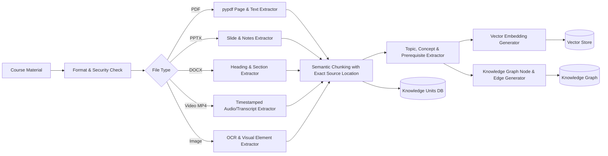
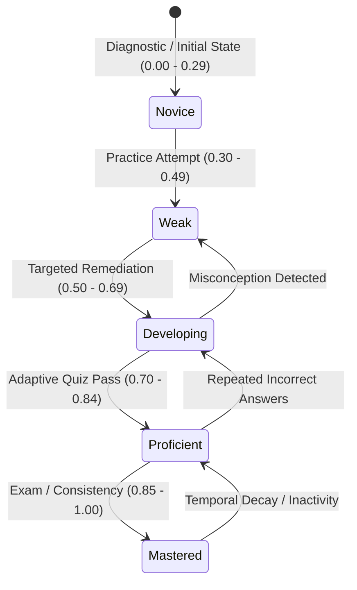
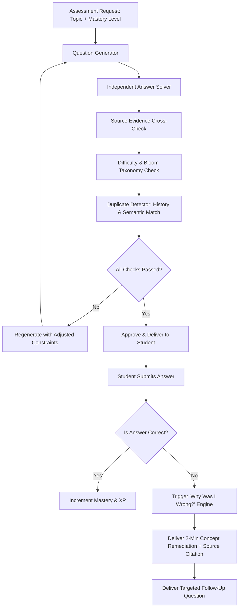
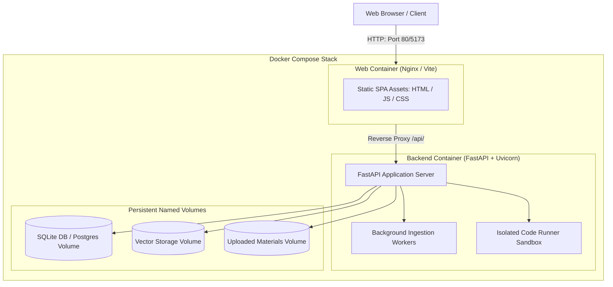

# EduPath AI — Architecture Diagrams (Mermaid)

## 1. System Architecture

```mermaid
flowchart TD
    User([Learner / Student])
    
    subgraph Frontend ["Frontend Web Application (Vite + React)"]
        Dash[Dashboard & Timeline]
        TutorUI[Grounded Tutor & Scoped Chat]
        AssessUI[Adaptive Quiz & Misconception Engine]
        GraphUI[Interactive Knowledge Graph]
        PlanUI[Adaptive Study Planner]
        FlashUI[SM-2 Flashcards & Revision]
        CodeUI[Sandboxed Coding Lab]
    end

    subgraph BackendAPI ["FastAPI REST Services"]
        RouterAuth[/api/auth/]
        RouterCourse[/api/courses/]
        RouterTutor[/api/tutor/]
        RouterAssess[/api/assessment/]
        RouterLearner[/api/learner/]
        RouterPlan[/api/planner/]
        RouterSandbox[/api/coding/]
    end

    subgraph IntelligenceCore ["Shared Intelligence Engine"]
        IngestionSvc[Multimodal Ingestion Pipeline]
        GraphSvc[Knowledge Graph Builder]
        RAGSvc[Hybrid Retriever: Vector + BM25 + Graph]
        GroundGate[Grounding & Refusal Gate]
        LearnerSvc[Learner Mastery Engine]
        MisconceptionSvc[Why Was I Wrong? Engine]
        ValidationSvc[Question Validation Pipeline]
    end

    subgraph StorageLayer ["Persistence Layer"]
        RelDB[(Relational DB: SQLite / Postgres)]
        VecStore[(Vector Index: Embeddings)]
        DocStore[(Document Storage: Uploads)]
    end

    User --> Frontend
    Frontend --> BackendAPI
    BackendAPI --> IntelligenceCore
    IntelligenceCore --> StorageLayer
```


## 2. Ingestion Pipeline


## 3. RAG Pipeline & Grounding Gate
```mermaid
flowchart TD
    Query[Student Query] --> Intent[Query & Concept Parser]
    Intent --> Retriever
    
    subgraph Retriever ["Hybrid Retrieval"]
        VecRet[Vector Semantic Search]
        KeyRet[BM25 Keyword Search]
        GraphRet[Knowledge Graph Traversal]
    end
    
    VecRet --> Fusion[Reciprocal Rank Fusion (RRF)]
    KeyRet --> Fusion
    GraphRet --> Fusion
    
    Fusion --> Rerank[Relevance Reranking]
    Rerank --> Gate{Grounding Gate\nEvidence Score >= 0.68?}
    
    Gate -->|No| Refuse["I couldn't find sufficient evidence in your course material."]
    Gate -->|Yes| GroundedGen[Grounded Response Synthesis]
    
    GroundedGen --> CiteVerify[Citation Verification: Page / Slide / Timestamp]
    CiteVerify --> FinalResponse[Grounded Answer + Verified Citations]
```

## 4. Learner Model & Mastery Dynamics


## 5. Adaptive Assessment & Validation Pipeline


## 6. Deployment Architecture

